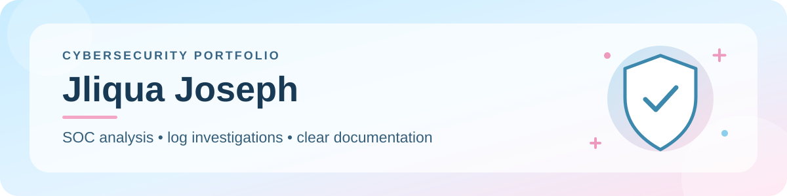

  
    
  
  
<strong>Hi, I'm Jliqua 👋🏾</strong> I turn logs and other evidence into clear findings and practical next steps.

  

    
  

---

### 🌷 A little about me

I'm building a career in cybersecurity with a focus on SOC analysis, alert triage, and incident investigation. My WGU cybersecurity coursework and hands-on lab work help me practice following the evidence, explaining what I found, and identifying sensible next steps.

### 📂 Projects

- **[SOC Detection Lab](https://github.com/Jliquaj/SOC-Detection-Lab):** Used Splunk to review sample Apache logs, including `401` responses and requests to sensitive paths. The repo documents the investigation steps and visuals.

### 🛠️ Skills & tools

| Focus | What I've worked with |
| --- | --- |
| **Security analysis** | Alert triage, log review, IOC investigation, incident documentation |
| **SIEM & logs** | Splunk, Apache access logs, Windows event logs |
| **Systems & network** | Windows, Linux, Wireshark |

### 🎓 Certifications

| CompTIA | More |
| --- | --- |
| [A+](https://www.credly.com/badges/781d950a-cba1-40d3-8554-7b9b8cda7072/public_url) · [Network+](https://www.credly.com/badges/b3f6a8b6-253e-4223-b2fe-0aa83305575e/public_url) · [Security+](https://www.credly.com/badges/06906581-179b-4b50-8240-7474739adcad/public_url) | ITIL Foundation |
| [Project+](https://www.credly.com/badges/37d72834-bdbb-46f4-8587-61afb3352747/public_url) · [Data+](https://www.credly.com/badges/c2cd7564-0d57-465f-b029-b3c0d920fe20/public_url) | |

---

🩵 <strong>Currently building:</strong> More investigations that show the evidence, queries, and reasoning behind each conclusion.

